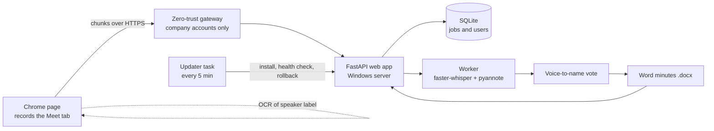

# Meeting Transcription: Case Study

> A self-hosted tool that turns Google Meet calls into Word meeting minutes with a speaker-labeled transcript, built for an events company in Brazil.
> **Source code is private.** This repository documents the project; a live walkthrough is available on request.

Status: in development

## The problem

The team holds many internal meetings on Google Meet, and decisions got lost because nobody had time to write minutes. Paid note-taking tools charge per seat every month, and the company did not want meeting audio leaving its own hardware. The goal: minutes in Word, with who said what, at zero monthly cost.

## What I built

- **One-click recording in the browser**: the employee opens an internal page in Chrome, picks the Meet tab, and the page records it and uploads it in chunks while the meeting runs.
- **On-prem transcription**: a Windows server with no GPU transcribes Brazilian Portuguese with Whisper large-v3-turbo and splits the voices with pyannote speaker diarization.
- **Speaker names**: while recording, a background worker reads the name label of the active speaker from the Meet tab with OCR. On the server, a voting step maps each diarized voice to a name only when the evidence is strong enough (minimum speaking time, a margin over the runner-up, and overlap rules).
- **"Who is each voice?" dialog**: if a voice is still unnamed, the download page shows short excerpts of what that voice said and asks the user to pick the name, then rebuilds the Word file.
- **Word minutes**: a .docx with the meeting details and the full transcript labeled by speaker.
- **Admin panel**: user list, everyone's meetings and their status, usage, external API health and a system page with the installed version.
- **Self-updating server**: every 5 minutes the server compares its version with the main branch, waits for the transcription queue to empty, installs, runs a health check and rolls back automatically if anything fails.

## Architecture

- **Zero monthly cost**: open models running on hardware the company already owned, no paid API in the pipeline.
- **Privacy by design**: audio and minutes never leave the company server, and a zero-trust gateway lets in only company accounts.
- **CPU only**: model versions and thread counts were measured on the real server (about 1.1 hours of processing per hour of meeting in the first benchmark).
- **Safe deploys**: pinned dependencies installed from a hashed lockfile, CI with a test suite and a Windows install check, and automatic rollback on the server.

## How it was built

- **AI-assisted development**: the code was written with AI coding agents, each one working on a scoped task in its own branch.
- **Human in the loop**: every change went through a review step before merging, and nothing reached production without my explicit approval.
- **Security review**: a dedicated audit in two rounds, followed by a retest of every fix.
- **Real-meeting testing**: features were validated in live Google Meet calls, not only in automated tests.

## Scale

- ~7.6k lines of Python, ~2.2k lines of JavaScript and ~1.1k lines of PowerShell
- 16 test files, 436 automated tests passing in CI

## What is next

A meeting assistant that joins calls on its own from a dedicated calendar, the way commercial note takers do, so nobody has to start a recording. A prototype already joins as a signed-in participant and identifies the speaker order correctly; capturing its audio is the current step. Summaries will come from a small open model running on the same server.

## My role

Product owner and developer: I defined the scope and the no-subscription constraint, designed the architecture, built the web app, the transcription worker, the speaker naming, the Windows installer and the self-updating deploy, and ran the tests in real meetings. I worked with AI coding agents throughout, reviewing and approving every change.

---
Built by **Victor Sestrem** · [LinkedIn](https://www.linkedin.com/in/victor-sestrem/) · victor-sestrem@hotmail.com
